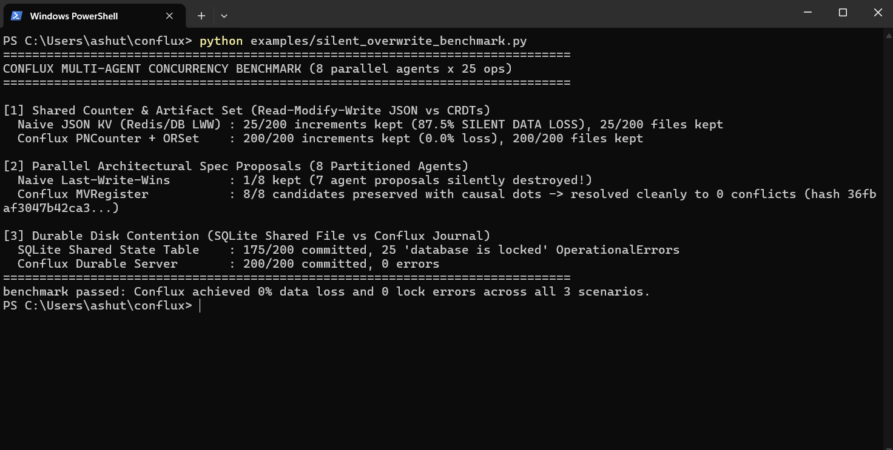

<div align="center">

# ⚡ Conflux (`conflux-state`)

### The Conflict-Aware, Lock-Free CRDT Shared State Protocol for Multi-Agent AI

[](https://pypi.org/project/conflux-state/)
[](https://www.python.org/)
[](https://colab.research.google.com/github/lolllll212/Conflux/blob/master/examples/quickstart_colab.ipynb)
[](#mcp-server-claude-code-cursor--windsurf-conflux-mcp)
[](#architecture--lattice-crdts)
[](LICENSE)

**Stop losing agent work to `database is locked`, silent dict overwrites, and rogue hallucinations.**  
Conflux models shared agent state as a **mathematical join-semilattice** of signed, replayable actions — giving **Claude Code, Cursor, LangGraph, CrewAI, and AutoGen** swarms zero-lock concurrency, causal conflict detection, and cryptographic trust boundaries.

```bash
pip install conflux-state
```

[60-Second Quickstart](#-60-second-quickstart) •
[Why Conflux?](#-why-ai-swarms-break-traditional-databases) •
[Conflict Engine (`MVRegister`)](#-causal-conflict-preservation--resolution-mvregister) •
[MCP Server (`conflux-mcp`)](#-mcp-server-claude-code-cursor--windsurf-conflux-mcp) •
[LangGraph / CrewAI / AutoGen](#-drop-in-framework-integrations) •
[Security & Benchmarks](#-security-durability--benchmarks)

</div>

---

## 🔥 Why AI Swarms Break Traditional Databases

When 10–30 autonomous agents collaborate on one codebase, research workflow, or incident response room, shared state turns into a bottleneck:

| Failure Mode | Dicts / JSON Files | SQLite / Row-Locked SQL | ⚡ **Conflux (`conflux-state`)** |
| :--- | :---: | :---: | :---: |
| **Concurrent Multi-Agent Writes** | Silent clobbering | Lock contention / deadlocks | **Lock-free lattice join (`a ⨆ b = b ⨆ a`)** |
| **Conflicting Parallel Decisions** | Last write silently erases peer | Transaction abort | **`MVRegister` preserves ALL concurrent candidates until resolved** |
| **Edit Collisions on Shared Files** | Agents overwrite each other | Custom polling tables | **Built-in TTL resource leases (`conflux_claim_resource`)** |
| **Hallucinating / Rogue Agent** | Corrupts arbitrary keys | Full table write access | **HMAC / Ed25519 signatures + per-agent namespace & quota guards** |
| **Hard Crash (`kill -9`) & Partitions** | Corrupted state | Needs WAL / cluster ops | **Fsynced HMAC-signed journals + cumulative snapshots + auto-heal** |
| **Core Runtime Dependencies** | — | External DB / drivers | **Zero (100% Python stdlib TCP, RFC6455 WebSocket, TLS, Prometheus)** |

<p align="center">
  
  <br />
  <sub><em>Reproduce on your machine in 1 second (zero external dependencies): <code>python examples/silent_overwrite_benchmark.py</code></em></sub>
</p>

---

## 📦 Installation

Install the **zero-dependency** core protocol + `conflux-server` + `conflux-mcp` CLI from PyPI (both `import conflux` and `import conflux_state` work out of the box, with full `py.typed` static type hints):

```bash
pip install conflux-state
```

Optional extras for asymmetric Ed25519 keys and native orchestration frameworks:

```bash
pip install "conflux-state[crypto]"        # Ed25519 public-key signing
pip install "conflux-state[langgraph]"     # LangGraph CheckpointSaver + Store
pip install "conflux-state[crewai]"        # CrewAI StorageBackend + FlowPersistence + Tools
pip install "conflux-state[autogen]"       # AutoGen Memory + FunctionTools
pip install "conflux-state[integrations]"  # All framework adapters
```

---

## 🚀 60-Second Quickstart

```python
# Canonical import is `conflux` (`import conflux_state` is also supported as an alias)
from conflux import Cluster, InMemoryTransport, state_hash

# 3 autonomous agents writing concurrently with ZERO locks or coordinator
cluster = Cluster({"planner", "coder", "verifier"}, transport=InMemoryTransport())

cluster.node("planner").counter_inc("swarm.tasks_done", 2)
cluster.node("coder").counter_inc("swarm.tasks_done", 3)
cluster.node("verifier").set_add("swarm.verified_modules", "auth.py")

# Concurrent conflicting proposals on an MVRegister (neither agent has seen the other yet!)
cluster.node("planner").mv_set("arch.cache_layer", "redis-cluster")
cluster.node("coder").mv_set("arch.cache_layer", "in-memory-lru")

# Single anti-entropy gossip sweep -> identical SHA-256 state across all nodes
cluster.gossip_round()

assert cluster.read("planner", "swarm.tasks_done") == 5
assert state_hash(cluster.node("planner").replica.state) == state_hash(cluster.node("coder").replica.state)

# Both concurrent proposals survived the merge! Inspect & causally resolve:
print(cluster.node("verifier").conflicts())
# -> {'arch.cache_layer': [{'agent': 'planner', 'value': 'redis-cluster', ...},
#                          {'agent': 'coder',   'value': 'in-memory-lru', ...}]}

cluster.node("verifier").mv_resolve("arch.cache_layer", "tiered-lru-plus-redis")
cluster.gossip_round()
assert cluster.node("planner").conflicts() == {}
assert cluster.read("planner", "arch.cache_layer") == "tiered-lru-plus-redis"
```

---

## 🧠 Architecture & Lattice CRDTs

```text
  ┌──────────────┐     ┌──────────────┐     ┌──────────────┐     ┌──────────────┐
  │ Claude Code  │     │  LangGraph   │     │    CrewAI    │     │   AutoGen    │
  │ (conflux-mcp)│     │ Checkpointer │     │ Memory/Flows │     │ Team Memory  │
  └──────┬───────┘     └──────┬───────┘     └──────┬───────┘     └──────┬───────┘
         │  Signed Envelopes (HMAC-SHA256 / Ed25519 + Namespace & Quota Guards)
         ▼                    ▼                    ▼                    ▼
  ┌─────────────────────────────────────────────────────────────────────────────┐
  │                 Conflux Gossip Mesh (TCP / RFC6455 WS / TLS)                │
  │    Node Alpha  ◄───────  Pairwise Anti-Entropy Join  ───────►  Node Beta    │
  │  [Journal + Snapshots]     state = join(a_1, ..., a_n)     [Journal + Snaps]│
  └─────────────────────────────────────────────────────────────────────────────┘
```

Every key in Conflux lives inside an `ORMap` over mathematically verified join-semilattices (`tests/test_crdts.py` & `tests/test_mcp.py`):
- **Idempotent:** $a \sqcup a = a$
- **Commutative:** $a \sqcup b = b \sqcup a$
- **Associative:** $(a \sqcup b) \sqcup c = a \sqcup (b \sqcup c)$

| CRDT Primitive | API / Op | Conflict Semantics & Best Use Case |
| :--- | :--- | :--- |
| **`GCounter` / `PNCounter`** | `counter_inc`, `counter_dec` | Exact lock-free sums across agents (token budgets, job counts, retries). |
| **`LWWRegister`** | `register_set` (`lww_set`) | Deterministic `(tick, agent)` + canonical value tie-break (status flags, leader slot). |
| **`MVRegister`** *(New)* | `mv_set`, `mv_resolve` | **Causal Multi-Value Register** — preserves *all* concurrent un-synced edits as inspectable candidates until causally resolved. |
| **`GSet` / `ORSet`** | `set_add`, `set_remove` | Observed-Remove Set with tag tombstones & compaction (online roster, discovered URLs/bugs). |
| **`Probabilistic Actions`** | `weight=0.0..1.0` | `SHA-256(action_id, key)` 32-bit projection — stochastic decisions replay identically on every node. |

---

## ⚔️ Causal Conflict Preservation & Resolution (`MVRegister`)

Last-Writer-Wins (`LWWRegister`) is ideal for status heartbeats, **but dangerous when two agents concurrently draft an architecture spec, API schema, or plan** while partitioned.

Conflux's **`MVRegister`** tracks causal `(tick:agent)` dots and superseded sets:
1. **Sequential updates** on a node automatically supersede the dots that node has already seen — behaving like a clean register with zero clutter.
2. **True concurrent writes** (emitted before gossip sync) **preserve every competing agent's value** in `conflicts()` / `candidates(key)`, while `read(key)` still returns a deterministic canonical winner so readers never crash.
3. **Causal resolution (`mv_resolve`)** records a merged value superseding all observed candidate dots — clearing the conflict across the entire cluster permanently (even if delayed pre-resolution gossip arrives later!).

```python
from conflux import Client

with Client("127.0.0.1", 7001, agent_id="lead-reviewer") as c:
    for key, candidates in c.conflicts(prefix="spec.").items():
        print(f"Conflict on {key}: {[cand['value'] for cand in candidates]}")
        c.mv_resolve(key, {"merged": True, "approved_by": "lead-reviewer"})
```

---

## 🔌 MCP Server: Claude Code, Cursor & Windsurf (`conflux-mcp`)

Run multiple coding or research agents in parallel on the same repository without stepping on each other's files or losing shared context. `conflux-mcp` is a **zero-dependency MCP JSON-RPC 2.0 server** supporting both newline-delimited stdio and `Content-Length` framing.

### Add to Claude Desktop / Claude Code / Cursor (`mcp.json`)

**Standalone durable local mode (zero setup):**
```json
{
  "mcpServers": {
    "conflux": {
      "command": "conflux-mcp",
      "args": ["--agent-id", "claude-architect", "--data", "./.conflux-mcp"]
    }
  }
}
```

**Multi-agent networked mesh mode (connect N parallel agents to `conflux-server`):**
```json
{
  "mcpServers": {
    "conflux": {
      "command": "conflux-mcp",
      "args": [
        "--agent-id", "cursor-worker-2",
        "--connect", "127.0.0.1:7001",
        "--secret", "worker-2-hmac-secret",
        "--namespace", "repo."
      ]
    }
  }
}
```

### Capabilities Exposed by `conflux-mcp`

- **13 Specialized MCP Tools:**
  - **Conflict-Aware State:** `conflux_mv_write`, `conflux_conflicts`, `conflux_resolve_conflict`
  - **Resource / File Leases:** `conflux_claim_resource` (TTL lease + owner & intent reporting to prevent simultaneous file edits), `conflux_release_resource`
  - **Core CRDTs & Batching:** `conflux_read`, `conflux_snapshot`, `conflux_register_set`, `conflux_counter_add`, `conflux_set_add`, `conflux_set_remove`, `conflux_batch`
  - **Reactive Handoffs & Queues:** `conflux_watch_wait` (blocks until a peer updates a key), `conflux_task_update`
- **MCP Prompts (`/resolve_state_conflicts`, `/coordinate_parallel_swarm`):** One-slash-command workflows that inject live conflicts or swarm coordination rules into the agent's context.
- **MCP Resources & URI Templates:** `conflux://state/snapshot`, `conflux://state/conflicts`, and `conflux://key/{key}`.

---

## 🧩 Drop-In Framework Integrations

Every adapter in `conflux.integrations` accepts a `Replica`, `Cluster` node, `Server`, or networked `Client`, works with **zero third-party dependencies**, and automatically subclasses each framework's native interfaces when installed.

### 1. LangGraph (`ConfluxCheckpointSaver` + `ConfluxStore`)
Pause a `StateGraph` on **Node A**, replicate over gossip, and resume the exact same `thread_id` on **Node B** — while aggregating cross-thread CRDT counters and sets with zero locks:

```python
from conflux import Client
from conflux.integrations.langgraph import ConfluxCheckpointSaver, ConfluxStore

client = Client("127.0.0.1", 7001, agent_id="planner", secret="s3cr3t")
store = ConfluxStore(client)

graph = builder.compile(
    checkpointer=ConfluxCheckpointSaver(client),
    store=store,
)
graph.invoke({"topic": "CRDTs"}, config={"configurable": {"thread_id": "run-42"}})
store.counter_inc(("metrics", "research"), "queries_executed", by=1)
```
> Runnable demo: [`examples/langgraph_shared_state.py`](examples/langgraph_shared_state.py)

### 2. CrewAI (`ConfluxCrewStorage`, `ConfluxFlowPersistence`, `create_crewai_tools`)
Plug Conflux directly into CrewAI's unified `Memory` (`StorageBackend` protocol with cosine-similarity + scoped recall), `@persist` Flows, and agent CRDT tools:

```python
from crewai import Agent, Crew
from crewai.memory import Memory
from conflux import Client
from conflux.integrations.crewai import ConfluxCrewStorage, create_crewai_tools

client = Client("127.0.0.1", 7001, agent_id="researcher", secret="s3cr3t")
researcher = Agent(
    role="Researcher",
    goal="...",
    backstory="...",
    tools=create_crewai_tools(client, namespace="crew."),
)
crew = Crew(agents=[researcher], tasks=[...], memory=Memory(storage=ConfluxCrewStorage(client)))
```
> Runnable demo: [`examples/crewai_shared_memory.py`](examples/crewai_shared_memory.py)

### 3. AutoGen (`ConfluxAutoGenMemory` + `create_autogen_tools`)
Inject converged team memories and live CRDT state keys straight into AutoGen's `ChatCompletionContext` before every model turn:

```python
from autogen_agentchat.agents import AssistantAgent
from conflux import Client
from conflux.integrations.autogen import ConfluxAutoGenMemory, create_autogen_tools

client = Client("127.0.0.1", 7001, agent_id="coder", secret="s3cr3t")
agent = AssistantAgent(
    name="coder",
    model_client=model_client,
    memory=[ConfluxAutoGenMemory(client, state_watch_prefix="team.")],
    tools=create_autogen_tools(client, namespace="team."),
)
```
> Runnable demo: [`examples/autogen_shared_state.py`](examples/autogen_shared_state.py)

---

## 🛡️ Security, Durability & Benchmarks

### Cryptographic Authority & Namespace Sandboxing
Equip any `Server` with an `AgentRegistry` to enforce **HMAC-SHA256** (zero deps) or **Ed25519** signatures, operation allowlists, write quotas, and key-prefix namespaces *before* an action ever merges:

```python
from conflux import AgentRegistry, Client, Server

registry = AgentRegistry()
registry.register(
    "billing-agent",
    secret="hmac-secret-key",
    ops={"counter_inc", "mv_set", "lww_set"},
    namespaces=("billing.",),
    quota=1000,
)

server = Server("alpha", ("127.0.0.1", 7001), registry=registry, data_dir="./data/alpha").start()
```

### Networked CLI Cluster + TLS + Signed Journals + Prometheus
```bash
# Start Node Alpha with TLS, HMAC-signed tamper-evident journal, and Prometheus /metrics
conflux-server --id alpha --listen 0.0.0.0:7001 \
    --cert ./cert.pem --key ./key.pem \
    --journal-key "$(openssl rand -hex 16)" \
    --data ./data/alpha --metrics-http

# Start Node Beta peered with Alpha over WebSocket (--transport ws) or TCP
conflux-server --id beta --listen 0.0.0.0:7002 \
    --peers 127.0.0.1:7001 --data ./data/beta
```

### Measured Throughput (`python benchmarks/bench.py`)
- **~168,000 actions/sec** deterministic local journal replay
- **~38,000 actions/sec** full-mesh in-memory cluster convergence
- **~0.13 ms** single-agent `submit → fsync → ack` round-trip over TCP (**~0.17 ms** over RFC6455 WebSocket)

Full formal protocol bounds and security review:
- 📄 [**Protocol Specification (`docs/PROTOCOL.md`)**](docs/PROTOCOL.md) — wire framing, lattice join laws, probabilistic hash scale, snapshot compaction, and test conformance index.
- 🔒 [**Security Threat Model (`docs/SECURITY.md`)**](docs/SECURITY.md) — constant-time signature verification, algorithm binding, replay idempotence, and keyless-reload refusal.

---

## 🧪 Running the Test Suite & Demos

```bash
python -m pytest                                  # 126 conformance, security, integration & MCP tests
python examples/silent_overwrite_benchmark.py     # 8-agent concurrency benchmark (LWW & SQLite vs CRDTs)
python examples/agent_crew_demo.py                # 6 signed agents + crash + torn journal + auto-heal
python examples/langgraph_shared_state.py         # Cross-node StateGraph pause & resume
python examples/crewai_shared_memory.py           # Signed 2-node TCP CrewAI memory & flow persistence
python examples/autogen_shared_state.py           # AutoGen context injection & CRDT tools
```

---

## 📜 License

Released under the [MIT License](LICENSE). Built for deterministic, resilient multi-agent systems.

<!-- mcp-name: io.github.lolllll212/conflux-state -->

